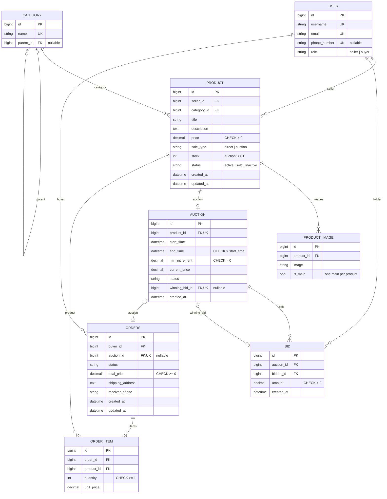

# سامانه فروش و مزایده کالا (BidBazaar)

> An online marketplace with direct sales and timed auctions — Django & PostgreSQL.

سامانه فروش و مزایده کالا با **جنگو** و **PostgreSQL**؛ پروژه درس برنامه‌نویسی وب (موضوع ۳.۷: فروش و مزایده کالا).

فروشنده کالا را برای **فروش مستقیم** یا **مزایده زمان‌دار** ثبت می‌کند و خریدار کالا را می‌خرد یا روی آن پیشنهاد قیمت می‌دهد. در پایان مزایده، بالاترین پیشنهاد برنده می‌شود و برای برنده سفارش ساخته می‌شود.

## وضعیت پروژه

| فاز | محتوا | وضعیت |
|---|---|---|
| ۱ | تعریف وب‌اپلیکیشن‌ها، نمودار فرآیندها، طراحی و تعریف مدل‌ها | ✅ |
| ۲ | view، url، template، فرم‌ها و داده آزمایشی | ⏳ |
| ۳ | Manager، session و cookie، ثبت لاگ | ⏳ |
| ۴ | تأیید ایمیل، تست‌ها، بهینه‌سازی template و گزارش نهایی | ⏳ |

## مستندات

- [نمودارهای فرآیند و نمودار ER](docs/diagrams/)



## ویژگی‌های فاز اول

- **۵ وب‌اپلیکیشن:** `accounts`، `catalog`، `auctions`، `orders`، `dashboard`
- **مدل کاربر سفارشی** با نقش فروشنده و خریدار
- **۸ مدل** با رابطه‌های چند به یک، یک به یک و خود-ارجاع
- **۹ قید دیتابیسی** (`CheckConstraint` و `UniqueConstraint`)؛ مثل قیمت مثبت، تک‌موجودی بودن کالای مزایده‌ای و زمان پایان بعد از شروع
- **سیاست حذف سنجیده:** `PROTECT` برای سابقه مالی، `CASCADE` برای داده وابسته، `SET_NULL` برای اشاره‌های اختیاری
- **پنل مدیریت** با فیلتر، جستجو و ویرایش درون‌صفحه‌ای (تصاویر، پیشنهادها و اقلام سفارش)
- **۵ نمودار فرآیند** به روش Swimlane برای فرآیندهای اصلی

## فناوری‌ها

Python 3.13 · Django · PostgreSQL 17 · psycopg · python-dotenv · Pillow

## ساختار پروژه

```
bidbazaar/
├── config/          تنظیمات و آدرس‌های اصلی
├── accounts/        کاربران و نقش‌ها
├── catalog/         دسته‌بندی، کالا و تصویر
├── auctions/        مزایده و پیشنهاد قیمت
├── orders/          سفارش و اقلام سفارش
├── dashboard/       داشبورد هر نقش
├── docs/            نمودارها
├── backups/         بکاپ دیتابیس
├── .env.example     نمونه تنظیمات
└── requirements.txt
```

## اجرا

۱. دریافت پروژه و نصب پکیج‌ها:

```bash
git clone https://github.com/Sanaalizadeh/bidbazaar.git
cd bidbazaar
python -m venv .venv
.venv\Scripts\activate          # Linux/macOS: source .venv/bin/activate
pip install -r requirements.txt
```

۲. یک دیتابیس و کاربر به اسم `bidbazaar` در PostgreSQL بسازید. بعد فایل `.env.example` را با اسم `.env` کپی کنید و مقادیر واقعی را در آن بنویسید.

۳. ساخت جدول‌ها و اجرا:

```bash
python manage.py migrate
python manage.py createsuperuser
python manage.py runserver
```

پنل مدیریت: `http://127.0.0.1:8000/admin/`

## بکاپ دیتابیس

بکاپ کامل (ساختار، قیدها و داده‌های آزمایشی) در `backups/bidbazaar_phase1.sql` است. برای بازگردانی روی یک دیتابیس خالی، به‌جای `migrate`:

```bash
psql -U bidbazaar -h localhost -d bidbazaar -f backups/bidbazaar_phase1.sql
```

## نویسندگان

ثنا علی زاده، ساناز دژواخ — درس برنامه‌نویسی وب
